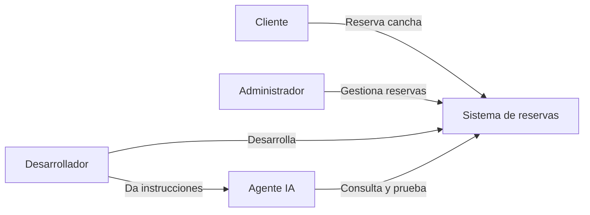
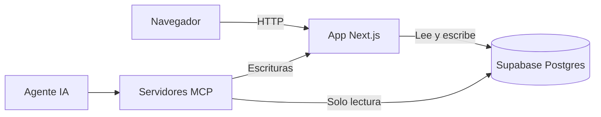
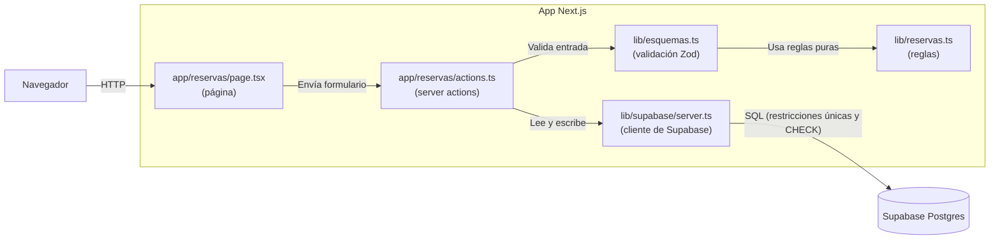

# Arquitectura

## 1. Contexto

Quién usa el sistema de reservas.

## 2. Contenedores

Piezas del sistema y cómo se conectan.

## 3. Componentes de la app (C4 nivel 3)

Archivos previstos dentro de la App Next.js (todavía no existen). La validación va en dos capas, según la ADR-0002.

