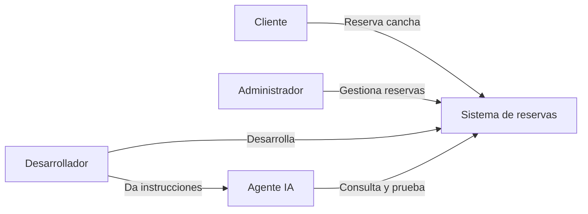
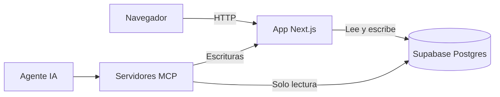
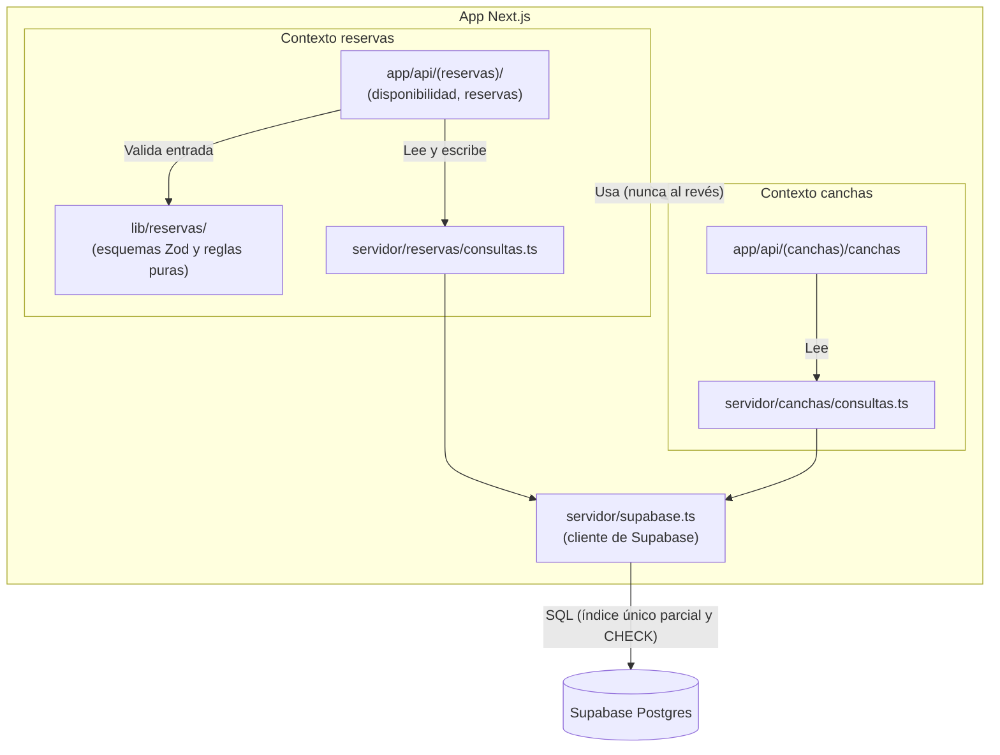

# Arquitectura

## 1. Contexto

Quién usa el sistema de reservas.

## 2. Contenedores

Piezas del sistema y cómo se conectan.

## 3. Componentes de la app (C4 nivel 3)

Monolito modular con dos contextos: `canchas` (canchas y tarifas) y `reservas` (clientes, reservas y disponibilidad). `reservas` puede usar `canchas`, nunca al revés; ESLint lo hace cumplir. `lib/` tiene solo reglas puras y esquemas Zod; `servidor/` accede a Supabase. La validación va en dos capas, según la ADR-0002.

Se quitaron, para simplificar, el navegador, `lib/canchas/tarifas.ts`, `lib/compartido/` y `servidor/http.ts` (formato de error y validación), y las flechas entre reglas puras; la dependencia reservas → canchas se muestra una sola vez, entre contextos.
