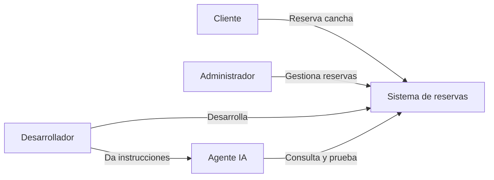
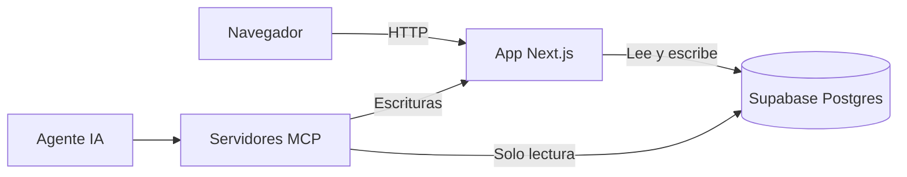
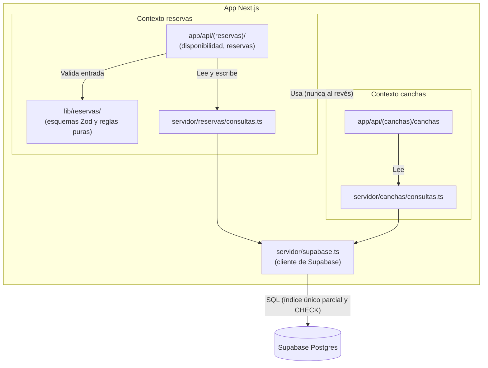

# Arquitectura

## 1. Contexto

Quién usa el sistema de reservas.

## 2. Contenedores

Piezas del sistema y cómo se conectan.

## 3. Componentes de la app (C4 nivel 3)

Monolito modular con dos contextos: `canchas` (canchas y tarifas) y `reservas` (clientes, reservas y disponibilidad). `reservas` puede usar `canchas`, nunca al revés; ESLint lo hace cumplir. `lib/` tiene solo reglas puras y esquemas Zod; `servidor/` accede a Supabase. La validación va en dos capas, según la ADR-0002.

Se quitaron, para simplificar, el navegador, `lib/canchas/tarifas.ts`, `lib/compartido/` y `servidor/http.ts` (formato de error y validación), y las flechas entre reglas puras; la dependencia reservas → canchas se muestra una sola vez, entre contextos.

## 4. Riesgos aceptados

Riesgos conocidos que se aceptan mientras el sistema sea un MVP que corre en local o en demos.

| Riesgo | Por qué se acepta en el MVP | Cuándo resolverlo |
|---|---|---|
| **Cualquiera puede crear reservas para cualquier `cliente_id`**, sin login ni límite de peticiones. La API usa la clave secreta de Supabase, que omite RLS. | No hay login por decisión (ADR-0001) y el sistema no está publicado. | **Antes de publicar en internet:** límite de peticiones por IP, verificar al cliente (login o código por SMS) y exigir `Content-Type: application/json` en el POST. |
| **Exposición de datos personales:** `GET /api/reservas/[id]` usa ids consecutivos y muestra el nombre del cliente; `CLIENTE_NO_EXISTE` revela qué ids de cliente existen. | Solo hay clientes de prueba del seed. | **Antes de cargar datos reales de clientes:** quitar el nombre de la respuesta o usar un identificador público aleatorio (uuid). |
