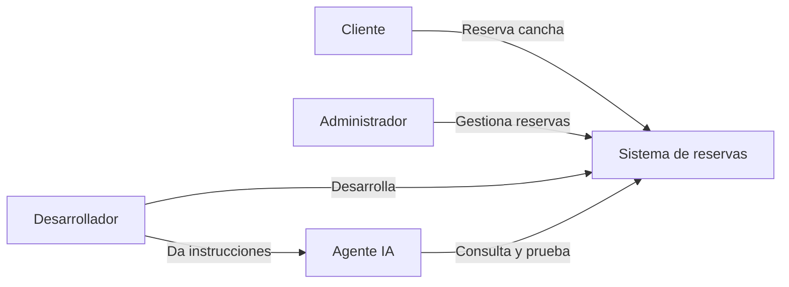
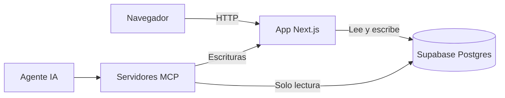
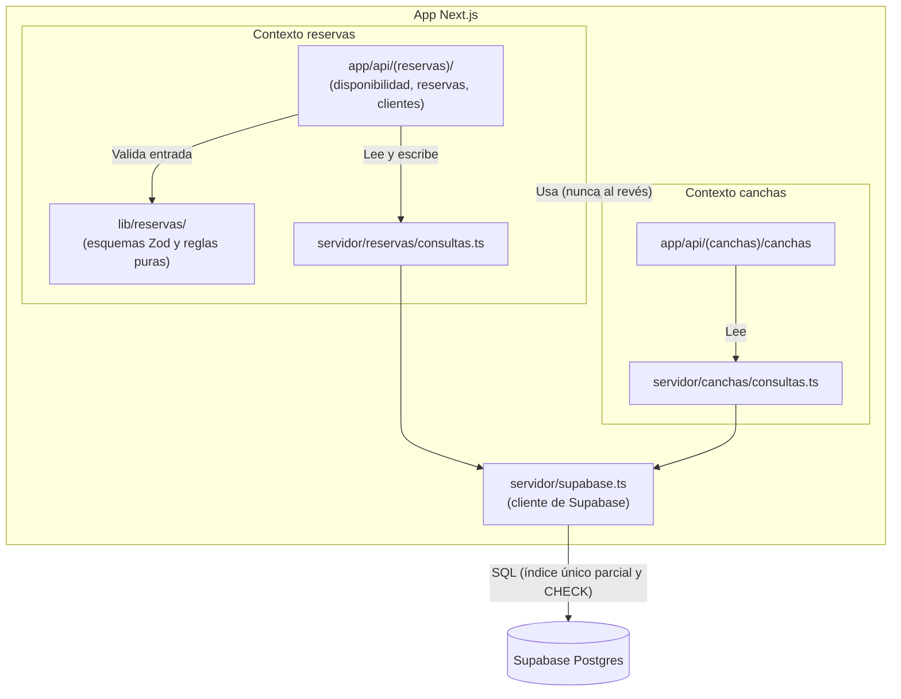
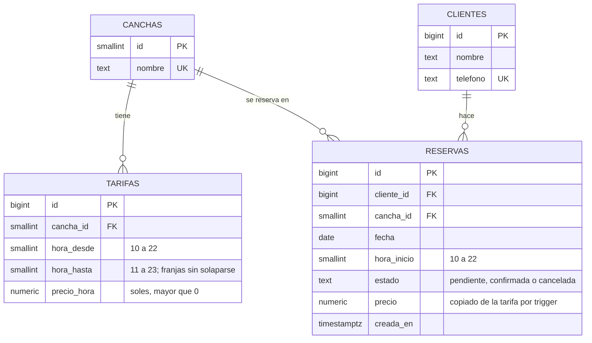

# Arquitectura

## 1. Contexto

Quién usa el sistema de reservas.

## 2. Contenedores

Piezas del sistema y cómo se conectan.

## 3. Componentes de la app (C4 nivel 3)

Monolito modular con dos contextos: `canchas` (canchas y tarifas) y `reservas` (clientes, reservas y disponibilidad). `reservas` puede usar `canchas`, nunca al revés; ESLint lo hace cumplir. `lib/` tiene solo reglas puras y esquemas Zod; `servidor/` accede a Supabase. La validación va en dos capas, según la ADR-0002.

Se quitaron, para simplificar, el navegador, `lib/canchas/tarifas.ts`, `lib/compartido/` y `servidor/http.ts` (formato de error y validación), y las flechas entre reglas puras; la dependencia reservas → canchas se muestra una sola vez, entre contextos.

## 4. Riesgos aceptados

Riesgos conocidos que se aceptan mientras el sistema sea un MVP que corre en local o en demos.

| Riesgo | Por qué se acepta en el MVP | Cuándo resolverlo |
|---|---|---|
| **Cualquiera puede crear reservas para cualquier `cliente_id`**, sin login ni límite de peticiones. También puede **cancelar o confirmar reservas ajenas** con `PATCH /api/reservas/[id]/estado`, probando ids consecutivos. La API usa la clave secreta de Supabase, que omite RLS. | No hay login por decisión (ADR-0001) y el sistema no está publicado. | **Antes de publicar en internet:** límite de peticiones por IP, verificar al cliente (login o código por SMS) y exigir `Content-Type: application/json` en el POST y el PATCH. El PATCH debe comprobar que quien cambia el estado es el dueño de la reserva o un cajero/administrador. |
| **Exposición de datos personales:** `GET /api/reservas/[id]` usa ids consecutivos y muestra el nombre del cliente; `CLIENTE_NO_EXISTE` revela qué ids de cliente existen. Además, `GET /api/clientes/[id]` muestra el nombre (el teléfono va enmascarado, solo los 3 últimos dígitos) y `GET /api/clientes/[id]/reservas` expone el **historial completo de reservas** de cualquier cliente probando ids consecutivos. | Solo hay clientes de prueba del seed. | **Antes de cargar datos reales de clientes:** quitar el nombre de la respuesta o usar un identificador público aleatorio (uuid), y que solo el propio cliente o un cajero/administrador pueda ver un cliente y su historial. |

### Riesgos resueltos

| Riesgo | Cómo se resolvió |
|---|---|
| **Precio guardado sin control** (riesgo 3): un agente IA o un script podía escribir cualquier precio. | Triggers `reservas_precio_insert` y `reservas_precio_update`: la base copia el precio desde `tarifas` y no deja cambiarlo (migración `*_precio_desde_tarifa.sql`). |
| **Transiciones de estado sin control en la base** (riesgo 4): una escritura directa podía pasar `confirmada → pendiente` o reactivar una `cancelada`. | Trigger `reservas_transicion_estado` (migración `*_transiciones_de_estado.sql`): rechaza los cambios no permitidos con SQLSTATE `RS001`, que la API responde como 409 `TRANSICION_NO_PERMITIDA`. La ruta `PATCH /api/reservas/[id]/estado` valida antes con `puedeCambiarEstado` y usa un UPDATE condicional por si dos peticiones llegan a la vez. |
| **El 409 dependía del nombre del índice y no había pruebas contra la base** (riesgo 5). | Comentario en el índice `reservas_bloque_ocupado_unico` y pruebas de integración (`npm run test:integracion`) para choques, precios y transiciones. |

## 5. Modelo de datos

Las 4 tablas del esquema (Postgres en Supabase) y sus relaciones.

El diagrama no muestra: el índice único parcial `(fecha, cancha_id, hora_inicio)` para reservas no canceladas (regla anti-choque), los triggers que fijan el precio desde `tarifas` y que validan los cambios de estado y que RLS está activo en las 4 tablas. Detalle en `supabase/migrations/`.

### Índices y rendimiento (EXPLAIN, ejercicio 2.5)

Índices de `reservas`:
- `reservas_pkey (id)`;
- `reservas_bloque_ocupado_unico (fecha, cancha_id, hora_inicio) WHERE estado <> 'cancelada'`, que es la regla anti-choque;
- `reservas_cliente_id_idx (cliente_id)`.

Medición en la base local con **101.400 reservas de prueba y 2.000 clientes** (unas 50 reservas por cliente), con `EXPLAIN (ANALYZE, BUFFERS)` y el SQL equivalente al de la app. Con solo las 4 reservas del seed, Postgres prefiere recorrer la tabla aunque exista el índice, así que la medición no sería realista. Los datos de prueba se borraron después.

| Consulta | Antes del índice en `cliente_id` | Después |
|---|---|---|
| **(a) Disponibilidad**: reservas no canceladas de una cancha y fecha (`horasOcupadas`) | **Index Only Scan** en `reservas_bloque_ocupado_unico`: 13 filas, 6 páginas, 0,04 ms | Igual (el índice nuevo no la afecta) |
| **(b) Mis reservas**: reservas de un cliente (`listarReservasDeCliente`) | **Seq Scan**: recorre 101.404 filas para devolver 50, 1.061 páginas, 4,29 ms | **Bitmap Index Scan** en `reservas_cliente_id_idx`: 50 filas, 61 páginas, 0,11 ms (unas 39 veces más rápido) |

**(a) ya estaba bien cubierta.** El índice anti-choque empieza por `fecha` y `cancha_id`, y su condición `WHERE estado <> 'cancelada'` coincide con la de la consulta. Además incluye `hora_inicio`, así que Postgres responde sin leer la tabla (Index Only Scan, `Heap Fetches: 0`).

**Decisión sobre `cliente_id`**
- **Paso 2 (modelo de datos inicial):** no se indexó, porque ninguna historia de usuario buscaba reservas por cliente.
- **Ejercicio 2.5:** se cambia esa decisión. "Mis reservas" (`GET /api/clientes/[id]/reservas`, ejercicio 2.4) filtra por cliente, y el EXPLAIN mostró que sin índice el costo crece con el total de reservas del sistema, no con las del cliente.
- El índice está en la migración `*_indice_reservas_cliente.sql`. Es simple, no compuesto con fecha y hora: cada cliente tiene decenas de reservas y ordenarlas en memoria cuesta 28 kB. También acelera la verificación de la FK al borrar un cliente.
- En una base grande en producción se crearía con `create index concurrently`, que no bloquea escrituras pero no puede ir dentro de la transacción de una migración. Para el MVP basta el índice normal.

