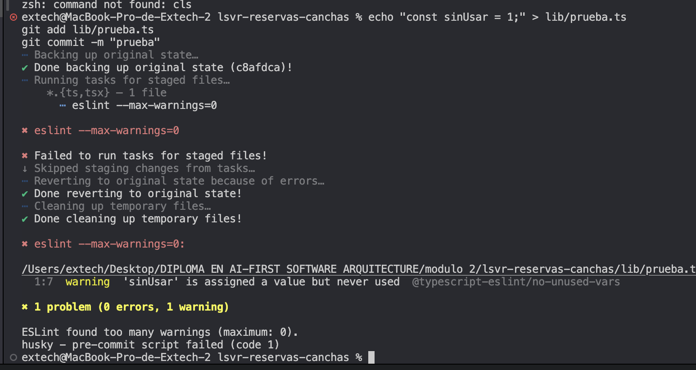

# Bitácora de evidencias · Sesión 1 · 2026-11-22
Proyecto: reservas de canchas (Next + Supabase). Repo: lsvr94/LSVRRESERVACANCHAS_MOD2

## Qué hice
- Proyecto con Next.js, Supabase CLI y Vitest; npm test pasa.
- AGENTS.md (manual para la IA) y CLAUDE.md conectado con @AGENTS.md.
- ADR-0001 (stack) y ADR-0002 (dónde viven las reglas).
- Diagramas C4: contexto, contenedores y componentes.
- Ejercicios 1.1 a 1.6 completos.

## Ejercicio 1.2
Vitest 5.1.1. package-lock.json fija las versiones. Al borrar node_modules
y correr npm ci, volvió la misma versión.

## Ejercicio 1.5 (problemas del AGENTS.md malo)
Regla vaga, comando ambiguo, secreto expuesto, borrar el lock, estilo no
escrito, falta mapa de carpetas.

## Errores y cómo los resolví
- AGENTS.md quedó vacío: en modo plan no se guarda hasta aprobar el plan.
- Claude no veía AGENTS.md: renombré la carpeta con VS Code abierto; la reabrí.

## Qué corregí del agente
- En el ADR-0001 inventó login y despliegue en Vercel, y olvidó Docker.

## Dudas para la sesión 2
- ¿El docente acepta Next + Supabase?

## Capturas

### husky-bloquea-commit.png

El hook pre-commit (husky + lint-staged) bloquea el commit de `lib/prueba.ts` porque ESLint encuentra una variable sin usar (`sinUsar`) y `--max-warnings=0` no admite ni una advertencia.
