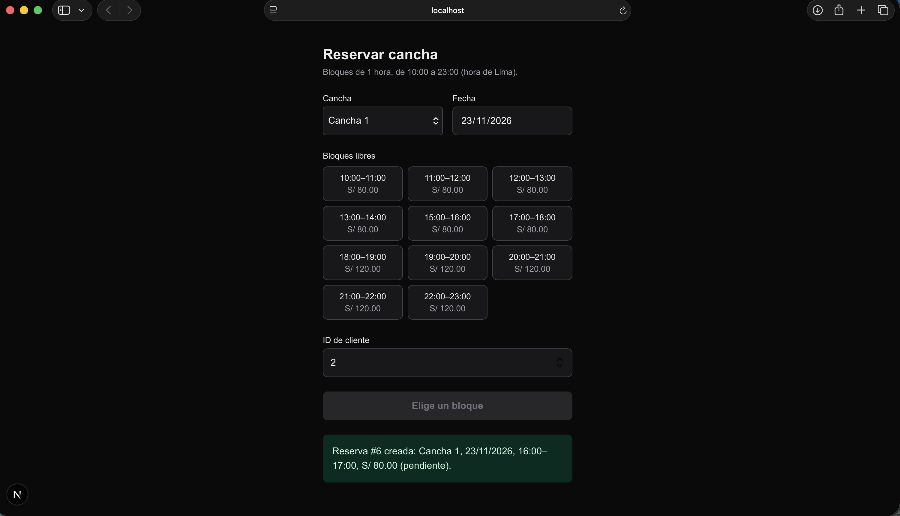
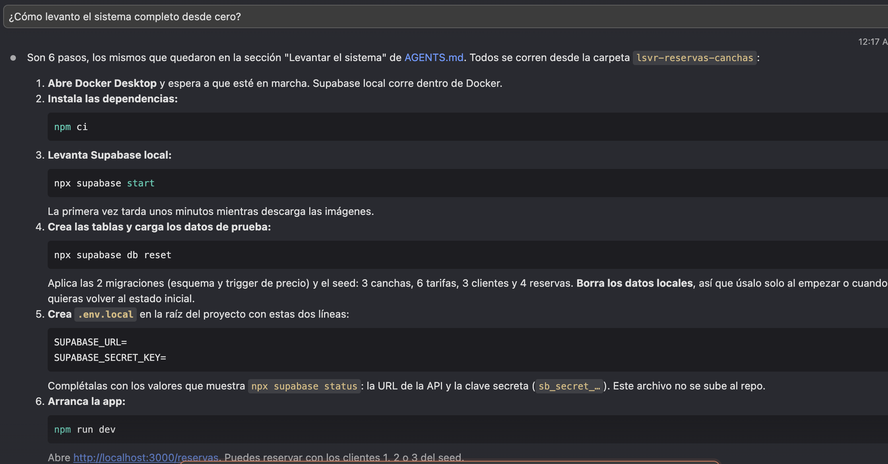
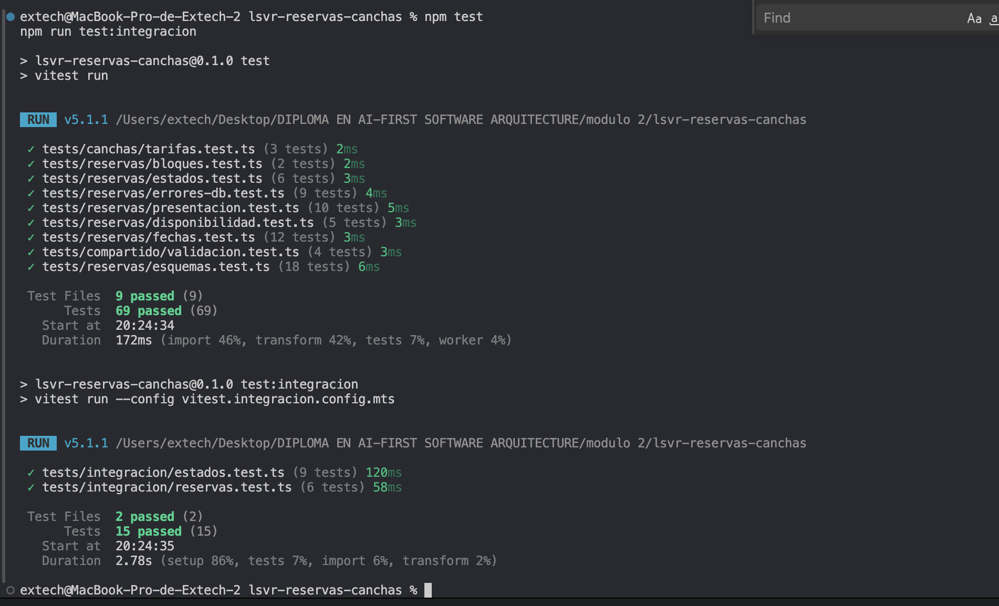

# Bitácora de evidencias · Sesión 1 · 2026-11-22
Proyecto: reservas de canchas (Next + Supabase). Repo: lsvr94/LSVRRESERVACANCHAS_MOD2

## Qué hice
- Proyecto con Next.js, Supabase CLI y Vitest; npm test pasa.
- AGENTS.md (manual para la IA) y CLAUDE.md conectado con @AGENTS.md.
- ADR-0001 (stack) y ADR-0002 (dónde viven las reglas).
- Diagramas C4: contexto, contenedores y componentes.
- Ejercicios 1.1 a 1.6 completos.

## Ejercicio 1.2
Vitest 5.1.1. package-lock.json fija las versiones. Al borrar node_modules
y correr npm ci, volvió la misma versión.

## Ejercicio 1.5 (problemas del AGENTS.md malo)
Regla vaga, comando ambiguo, secreto expuesto, borrar el lock, estilo no
escrito, falta mapa de carpetas.

## Errores y cómo los resolví
- AGENTS.md quedó vacío: en modo plan no se guarda hasta aprobar el plan.
- Claude no veía AGENTS.md: renombré la carpeta con VS Code abierto; la reabrí.

## Qué corregí del agente
- En el ADR-0001 inventó login y despliegue en Vercel, y olvidó Docker.

## Dudas para la sesión 2
- ¿El docente acepta Next + Supabase?

## Capturas

### husky-bloquea-commit.png

El hook pre-commit (husky + lint-staged) bloquea el commit de `lib/prueba.ts` porque ESLint encuentra una variable sin usar (`sinUsar`) y `--max-warnings=0` no admite ni una advertencia.

## Sesión 2 · 22 al 25/11/2026 · Base de datos y API co-diseñadas con el agente

### Qué construí
- Base de datos en Supabase local con 4 tablas: canchas, tarifas, clientes y reservas.
- API en Next.js con dos contextos (canchas y reservas) como monolito modular:
  GET /api/canchas, GET /api/disponibilidad, POST /api/reservas,
  GET /api/reservas/[id], PATCH /api/reservas/[id]/estado,
  GET /api/clientes/[id] y GET /api/clientes/[id]/reservas.
- Contratos con Zod y formato único de error.
- Pantalla /reservas que usa solo la API, con "Mis reservas".
- Pruebas: 79 unitarias (npm test) y 28 de integración contra la base real
  (npm run test:integracion).
- Diagramas C4 actualizados y diagrama entidad-relación.

### Decisiones que tomé (el agente propuso, yo decidí)
- 4 tablas: agregué tarifas porque el precio cambia de día (S/ 80) a noche (S/ 120).
- "Recaudado" = suma de las reservas confirmadas. Confirmar = pagó.
- Sin login por ahora (coherente con ADR-0001).
- Disponibilidad vive en el contexto reservas para que la dependencia vaya en un
  solo sentido: reservas usa canchas, nunca al revés. ESLint lo hace cumplir.
- 404 solo para el recurso de la URL; 422 para datos inválidos del cuerpo.
- Zona horaria del negocio America/Lima; la base trabaja en UTC.
- El precio lo fija la base con un trigger y no se puede cambiar después
  (precio histórico).
- No separar canchas en un microservicio (ADR-0003).

### Lo que agregó el agente y acepté
- Regla para que dos tarifas no se solapen en la misma cancha (btree_gist).
- Carpeta servidor/ con 'server-only': la clave secreta nunca llega al navegador.
- ESLint impide que la pantalla importe de servidor/ o de @supabase/.
- Código de error propio (RS001) para no depender del texto de Postgres.

### Pruebas como especificación
- En cada paso el agente escribió primero las pruebas, comprobó que fallaban
  y después implementó.
- Dos reservas simultáneas al mismo bloque: una 201 y otra 409. Lo vi también
  en la pantalla con dos pestañas.
- Las pruebas encontraron errores reales: un id inválido se reportaba en el
  campo equivocado, y una prueba esperaba mal la cantidad de asteriscos.

### Revisión crítica (Paso 10)
- Riesgo 3 (precio solo en la app): corregido con trigger.
- Riesgo 4 (cambios de estado sin control en la base): corregido en el ejercicio 2.3.
- Riesgo 5 (sin pruebas contra la base real): corregido con pruebas de integración.
- Riesgos 1 y 2 (sin login, ids consecutivos): aceptados para el MVP y
  documentados en docs/arquitectura.md con cuándo resolverlos.

### Ejercicios
- 2.1 GET /api/clientes/[id] con teléfono enmascarado (riesgo 2).
- 2.2 docs/codigos-http.md: cada código HTTP con la capa que lo produce.
  El 409 lo producen tres capas distintas.
- 2.3 PATCH de estado con reglas en la API y en la base (trigger).
- 2.4 "Mis reservas" en la pantalla.
- 2.5 EXPLAIN con 101.400 reservas: "Mis reservas" hacía Seq Scan; con el
  índice en cliente_id pasó a ser unas 39 veces más rápida.
- 2.6 ADR-0003: no separar canchas; condición de revisión escrita.

### Errores y cómo los resolví
- El nombre interno seguía siendo "oam" en package.json: lo cambié a "lsvr".
- Advertencia de Vite por formato de configuración: se renombraron los
  archivos a .mts.
- Supabase local necesita Docker abierto y expone servicios en la red: lo
  apago cuando no lo uso.

### Dudas para la sesión 3
- ¿Acepta el docente el stack Next + Supabase y la convención 404/422?

### Capturas

